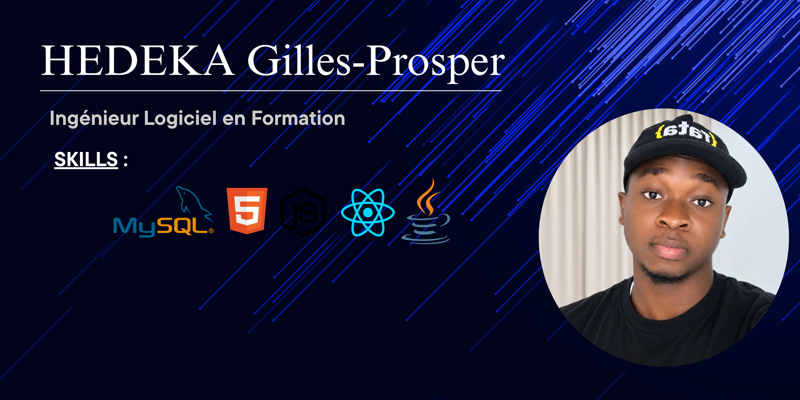

<!-- Bannière Canva : exporte-la en PNG (1500 x 500 px conseillé) et place-la dans assets/banner.png -->

  

<h1 align="center">Salut, je suis Gilles-Prosper 👋</h1>

  

  
  
  

---

## 🧑‍💻 À propos

> **« Do Best Of Yourself »** : donner le meilleur de soi-même.

Je suis **HEDEKA Koffi Gilles-Prosper**, étudiant en génie logiciel à l'**École Polytechnique de Lomé** (Togo). Passionné par le développement web et l'innovation, je m'investis dans la communauté tech togolaise.

- 📍 Lomé, Togo 🇹🇬
- 🎓 École Polytechnique de Lomé, Génie Logiciel
- 🔭 Je travaille actuellement sur : le développement web fullstack
- 🌱 J'apprends : React.js, Java, Prompt Engineering
- 🤝 Communautés : Tech Campus Club UL · Togo Code Run · GDG on Campus
- 💬 Parlons de : web, bases de données, design, projets étudiants

---

## 🛠️ Stack technique

   
  

---

## 🚀 Projets phares

| Projet | Description | Stack | Liens |
| --- | --- | --- | --- |
| **GoPrint** | Extension Chrome pour optimiser vos impressions web | JavaScript · HTML5 · CSS3 · Chrome API | [Code](https://github.com/Godwin-creator/GoPrint) |
| **PAC, Power Assistant Chatbot** | Interface web de diagnostic des pannes d'alimentation électrique (projet d'équipe, 5 développeurs) | JavaScript · HTML5 · CSS3 · Chart.js | [Démo](https://godwin-creator.github.io/PAC/) · [Code](https://github.com/Godwin-creator/PAC) |
| **Neon Survival** | Jeu de survie minimaliste, prototype réalisé en 60 minutes avec Cursor AI | TypeScript · Node.js · Gemini AI | [Code](https://github.com/Gilles11-r/NOM_DU_DEPOT) |

<!-- Ajoute ici d'autres projets (ex. ChainCacao, ton portfolio) en copiant une ligne du tableau -->

---

## 📊 Statistiques GitHub

  
  

  

---

## 💭 Citation

> *« Le code n'est pas seulement ce que nous écrivons, c'est l'empreinte que nous laissons dans le monde numérique. »*

  ⭐ Si un de mes projets vous plaît, n'hésitez pas à laisser une étoile !

